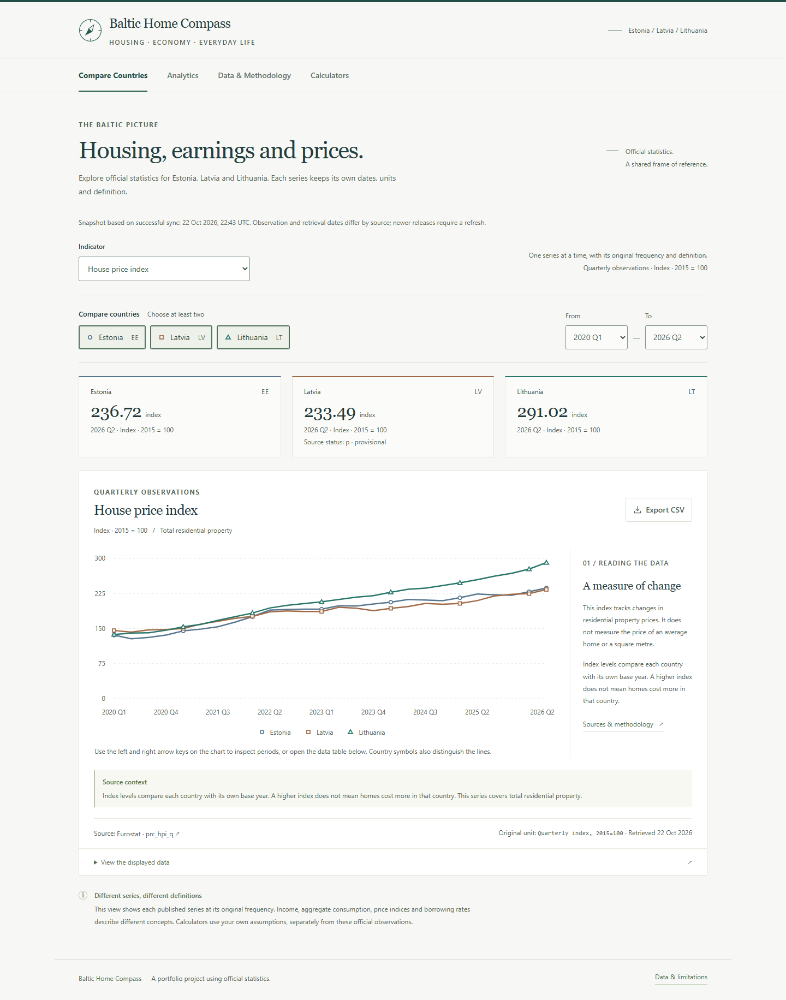

# Baltic Home Compass — portfolio material

Use these descriptions with the verified release. Add the actual demo URL after an approved deployment. The source repository remains private; do not describe it as open source or imply that a public source link is available. The text describes the application's behavior and technical decisions without attributing unsupported manual authorship or production usage.

## Short description

Baltic Home Compass combines official housing and household statistics for Estonia, Latvia and Lithuania with transparent mortgage scenarios. Users can compare eleven indicators, inspect source definitions and explore aligned housing, earnings and inflation trends. Personal calculators cover payments, household ratios, purchase budgets, interest-rate scenarios and amortization without saving financial inputs. The project includes a Python ingestion pipeline, FastAPI and PostgreSQL backend, plus a React/TypeScript static demo that works without hosted backend services. Missing observations and methodology breaks remain visible throughout the analysis.

## Technical description

Baltic Home Compass is a full-stack analytics portfolio project for comparing housing and household economic conditions in Estonia, Latvia and Lithuania. It separates verified Eurostat and ECB observations from the personal assumptions used in mortgage calculations.

Python adapters retrieve JSON-stat and CSV responses, validate metadata, dimensions, units, periods and source flags, and store attributed observations in PostgreSQL. Idempotent upserts preserve unchanged provenance; ingestion history exposes failures without replacing valid observations. SQL views and a Python analytics module align monthly, quarterly and annual series using complete-period rules. Comparisons respect the 2024 earnings methodology break and distinguish percentage-point changes from index growth.

FastAPI serves typed filtering, metadata, comparison and stateless calculator endpoints. The React/TypeScript interface provides country and period controls, charts, text summaries, data tables and CSV exports. Mortgage calculations follow a versioned specification in Python and TypeScript, with integer-cent schedules, a zero-rate case and explicit final-payment reconciliation. Cross-language and independent Decimal reference tests check financial consistency.

The public build uses committed statistical exports and browser calculations, so a demonstration can run on static hosting without a permanently available API or database. It contains 1,155 official observations across eleven indicators and fourteen analytical selections. Source dates, definitions and limitations remain available beside the results. The deployment and release-verification documentation records the actual checks and the remaining boundaries: national indicators are not property listings, published borrowing rates are not personal offers, and fixed-rate scenarios are estimates rather than forecasts.

## Technology list

React · TypeScript · Vite · Tailwind CSS · Recharts · Python · FastAPI · Pydantic · psycopg · PostgreSQL 18 · httpx · pandas · pytest · Vitest · Testing Library · Eurostat API · ECB Data API

## Engineering highlights

- **Data provenance:** metadata-checked official retrieval, attributed raw snapshots, per-observation flags and revision-aware PostgreSQL upserts.
- **Comparable periods:** complete monthly/quarterly aggregation, shared base/end periods, explicit missing results and break-aware cumulative comparisons.
- **Financial consistency:** a versioned Python/TypeScript contract, independent reference cases and reconciled integer-cent amortization schedules.
- **Two deployment modes:** the same interface supports a local FastAPI/PostgreSQL workflow and a standalone static release with precomputed analytics.
- **Reviewable interpretation:** original units, formulas, source dates, CSV exports and accessible tables accompany the charts and scenarios.

## Case study

### Problem and motivation

Housing and income headlines are easy to compare incorrectly. A property price index, a modelled earnings case and an ECB borrowing-cost series describe different things. They also arrive at different frequencies and may contain revisions or breaks. The project makes those distinctions visible while allowing a visitor to explore a separate scenario using their own financial assumptions.

The aim is a manageable individual portfolio project that demonstrates data engineering, analysis, visualization and full-stack development. It does not collect property listings, assess mortgage applications or claim to represent every household.

### Architecture and data collection

Official Eurostat JSON-stat and ECB CSV endpoints feed Python adapters. Small committed snapshots preserve the retrieved responses, request URLs and retrieval times. A native Windows PostgreSQL instance stores countries, datasets, indicator definitions, observations and ingestion runs. FastAPI reads these records and exposes typed endpoints. Versioned SQL migrations establish constraints and analytical views.

The static deployment boundary is separate: a deterministic export produces attributed observations and precomputed comparison scenarios. React reads those files in the public build. Refreshing a dataset is an explicit pipeline and release operation, rather than a hidden browser request or a claim that a snapshot is live.

### Cleaning, validation and analytics

Adapters verify country keys, dimensions, units, valid periods, duplicates and measure-specific numeric ranges. Missing values remain null and source flags are retained. A failed refresh preserves earlier observations; unchanged measurements retain their original provenance.

Complete calendar periods are required for averages: four quarterly house-price observations for an annual mean, three monthly HICP values for a quarter, and twelve for a year. Comparisons normalize compatible series to a common base. Rates and population shares use percentage-point changes. The 2024 earnings compiler break stops comparisons across the discontinuity. Rankings align the same base and end periods and do not equate a greater change with a better outcome.

### Interactive calculations

The mortgage experience includes payment estimates, entered ownership costs, household income/debt ratios, reverse purchase budgets, constant-rate scenarios and amortization tables. The TypeScript engine works independently in static mode; the Python API implements the same specification and can verify a complete result in local API mode.

Monthly interest and payments use an integer-cent ledger. The final payment clears the balance, and total interest comes from the schedule. Zero rates, missing income, fully cash-funded purchases and unsupported reverse-budget cases have explicit behavior. ECB benchmark rates are dated statistical context and never silently become a nominal contract rate. Financial inputs are held in memory rather than persisted.

### Challenges and decisions

| Challenge | Decision and consequence |
| --- | --- |
| Mixed frequencies and definitions | Preserve raw series; derive only explicitly aligned comparisons with complete source periods. This limits the available range. |
| Earnings methodology break | Keep the 2024 break flag and stop cumulative comparisons across it instead of drawing an uninterrupted growth claim. |
| Browser/API financial parity | Use a shared specification and cross-language result tests, including every schedule row, rather than assuming similar formulas are sufficient. |
| A useful demo without paid infrastructure | Publish reviewed exports and browser calculations; keep ingestion, PostgreSQL and FastAPI runnable locally. Public data updates require a deliberate release. |
| Personal assumptions beside official rates | Keep examples and entered values separate, label the benchmark's definition and avoid implied bank offers. |

### Results and limitations

The release preserves 1,155 official observations across eleven indicators, fourteen analytical selections and the existing financial scenario scope. It includes a native local development workflow and a static artifact prepared for a manual Cloudflare Pages release. Exact executed test results, accessibility findings, measured asset sizes and browser checks are in [release verification](release-verification.md); they are not performance or compliance guarantees.

The application does not provide city-level prices, asking rents, personal bank eligibility, variable-rate forecasts or transaction advice. Statistical comparisons cannot establish causes. The public dataset is a dated export. A published demo URL and any public source access remain future release decisions.

## Interview explanation — about 60–90 seconds

> Baltic Home Compass explores how housing and household economic indicators compare across Estonia, Latvia and Lithuania. The main challenge is making comparisons that are meaningful. A house-price index is not a property price, annual net earnings are a modelled case, and monthly inflation cannot simply be plotted as though it were annual income.
>
> The pipeline retrieves official Eurostat and ECB data, checks dimensions and units, and stores values with their provenance in PostgreSQL. The analytics layer requires complete periods and respects source breaks, including the 2024 earnings methodology change. The interface shows the definitions and missing results alongside the charts.
>
> Personal mortgage scenarios are kept separate. Python and TypeScript implement the same financial specification, with cent-based amortization and tests for full schedule agreement. No personal financial inputs are saved.
>
> One useful architectural decision is the static deployment mode. The backend demonstrates ingestion, SQL and typed APIs locally, while the portfolio demo can use verified exports and browser calculations without paying for a continuously running server. The result is a reproducible project whose assumptions and limitations can be inspected.

## Genuine screenshot gallery

The images below come from the working local production build. They are application captures, not design mockups. The mortgage screenshots show clearly labelled hypothetical inputs, not national averages. Copy images to a personal portfolio's own assets directory; links to images in a private repository will not load for public visitors.

| File | Suggested use and alternative text |
| --- | --- |
| [dashboard.png](screenshots/dashboard.png) | Main project image. “Baltic Home Compass dashboard comparing official house-price indices for Estonia, Latvia and Lithuania.” |
| [country-comparison.png](screenshots/country-comparison.png) | Country comparison detail. “Country comparison with aligned source periods, values and indicator context.” |
| [housing-earnings.png](screenshots/housing-earnings.png) | Analytics feature. “Housing and earnings comparison using a shared base period and source-break-aware data.” |
| [mortgage.png](screenshots/mortgage.png) | Calculator feature. “Mortgage calculator with hypothetical purchase assumptions and payment estimates.” |
| [repayment.png](screenshots/repayment.png) | Financial detail. “Constant-rate scenarios and reconciled mortgage repayment information.” |
| [mobile.png](screenshots/mobile.png) | Responsive layout. “Baltic Home Compass on a mobile-width screen.” |

## Demonstration sequence

For a short recording or interview demo:

1. Open Compare Countries, change an indicator and point out its unit and latest observation.
2. Open Analytics and explain one common-base comparison, then show the earnings break limitation.
3. Open Calculators, change a hypothetical rate and inspect the payment and scenario differences.
4. Inspect the repayment table's last balance and the stated rounding rules.
5. Finish with Data & Methodology to show source attribution and the dated snapshot.

Keep personal financial values out of recordings and screenshots. Use only labelled example inputs. Describe the implemented behavior and decisions you can explain; do not imply unaudited performance, production users, complete accessibility certification or a particular manual development contribution.
